# Y TẾ MỞ (YTeMo)

### Hệ sinh thái trí tuệ, nghiên cứu và đổi mới sáng tạo trong lĩnh vực y tế

**Y TẾ MỞ** là một sáng kiến công nghệ y tế mở, hướng tới xây dựng hệ
sinh thái hỗ trợ chăm sóc sức khỏe liên tục, dễ tiếp cận và có khả năng
cộng tác giữa người dân, nhân viên y tế, nhà nghiên cứu, kỹ sư, tổ chức
và cộng đồng.

Dự án không chỉ hướng tới một chatbot hỏi đáp y tế. Định hướng dài hạn
là xây dựng một **Personal Healthcare Companion Agent Ecosystem** --- hệ
sinh thái các tác nhân AI đồng hành cùng người dùng xuyên suốt hành
trình chăm sóc sức khỏe, phối hợp với chuyên gia y tế và các nguồn lực
phù hợp khi cần thiết.

> **Nguyên tắc minh bạch:** README này phân biệt rõ kiến trúc mục tiêu
> với những thành phần đã được xây dựng. Một năng lực được mô tả trong
> kiến trúc không đồng nghĩa năng lực đó đã được triển khai, kiểm chứng
> hoặc được phép sử dụng trong thực hành lâm sàng.

------------------------------------------------------------------------

## 1. Tầm nhìn

Việc chăm sóc sức khỏe không chỉ diễn ra trong một lần khám. Người dân
có thể cần hỗ trợ trước khi đến cơ sở y tế, trong quá trình khám chữa
bệnh, khi điều trị, sau khi xuất viện và trong quản lý sức khỏe lâu dài.

Y TẾ MỞ hướng tới giải quyết những nhu cầu liên tục đó thông qua một hệ
sinh thái công nghệ có khả năng:

-   Giúp người dân hiểu nhu cầu chăm sóc sức khỏe và tìm đúng dịch vụ
    phù hợp.
-   Hỗ trợ điều hướng, phối hợp và theo dõi hành trình chăm sóc.
-   Giúp người dùng hiểu chi phí, quyền lợi bảo hiểm và các lựa chọn
    liên quan.
-   Hỗ trợ duy trì chăm sóc sau khám, sau điều trị và trong dài hạn.
-   Kết nối công nghệ AI với chuyên môn của nhân viên y tế.
-   Thúc đẩy nghiên cứu, thử nghiệm và phát triển công nghệ y tế có chi
    phí phù hợp.
-   Tạo môi trường cộng tác để các bên cùng xác định vấn đề thực tế và
    phát triển giải pháp.

Mục tiêu cuối cùng là góp phần giúp dịch vụ chăm sóc sức khỏe trở nên dễ
tiếp cận, liên tục, minh bạch và phù hợp hơn với điều kiện của từng cá
nhân và cộng đồng.

## 2. Kiến trúc tổng thể

### 2.1. Personal Healthcare Companion Agent

Trung tâm của hệ thống là **Personal Healthcare Companion Agent** ---
tác nhân đồng hành chăm sóc sức khỏe cá nhân.

Thành phần này được thiết kế để:

-   Duy trì ngữ cảnh người dùng theo thời gian, trong phạm vi đã được
    người dùng đồng ý.
-   Hiểu nhu cầu, mục tiêu và những vấn đề còn chưa được giải quyết.
-   Phát hiện cơ hội cần hỗ trợ hoặc theo dõi tiếp theo một cách có kiểm
    soát.
-   Điều phối các Specialist Agents phù hợp với từng nhiệm vụ.
-   Theo dõi tiến độ và trạng thái của các nhu cầu chăm sóc.
-   Đánh giá lại tình hình khi có thông tin hoặc sự kiện mới.

Người dùng không cần tự chọn Agent hoặc biết chính xác tên một chức
năng. Companion là đầu mối tiếp nhận, làm rõ nhu cầu và điều phối hỗ
trợ.

### 2.2. Các lớp thành phần

  -----------------------------------------------------------------------
  Thành phần                          Vai trò
  ----------------------------------- -----------------------------------
  **Personal Healthcare Companion**   Đầu mối đồng hành, quản lý ngữ cảnh
                                      được cho phép và theo dõi nhu cầu

  **Proactive Engine**                Đề xuất hoạt động theo dõi hoặc hỗ
                                      trợ tiếp theo dựa trên sự kiện và
                                      quyền đồng ý

  **Agent Orchestrator**              Điều phối các Agent và quản lý
                                      luồng công việc

  **Specialist Agent Library**        Tập hợp các Agent chuyên trách từng
                                      nhiệm vụ

  **Independent Review Network**      Rà soát bằng chứng, tính nhất quán,
                                      giới hạn an toàn và nhu cầu chuyển
                                      chuyên gia

  **Longitudinal Care Workflow**      Theo dõi hành trình và tính liên
                                      tục của việc chăm sóc theo thời
                                      gian
  -----------------------------------------------------------------------

### 2.3. Luồng hoạt động định hướng

``` text
NGƯỜI DÙNG
    |
    v
PERSONAL HEALTHCARE COMPANION
    |
    +--> Hiểu nhu cầu và ngữ cảnh
    |
    +--> Theo dõi nhu cầu chưa được giải quyết
    |
    +--> Phát hiện nhu cầu cần hỗ trợ tiếp
    |
    v
AGENT ORCHESTRATOR
    |
    +--> SPECIALIST AGENTS
    |       |
    |       +--> Thực hiện nhiệm vụ chuyên trách
    |
    v
INDEPENDENT REVIEW NETWORK
    |
    +--> Rà soát bằng chứng và tính nhất quán
    +--> Chặn hoặc yêu cầu bổ sung khi chưa đủ cơ sở
    +--> Chuyển chuyên gia y tế khi cần
    |
    v
KẾT QUẢ CÓ GIỚI HẠN, NGUỒN GỐC VÀ MỨC ĐỘ TIN CẬY
    |
    v
THEO DÕI VÀ ĐỒNG HÀNH TIẾP TỤC
```

Đây là kiến trúc mục tiêu. Không phải tất cả các khối trong sơ đồ đã
được tích hợp hoặc vận hành trong phiên bản hiện tại.

## 3. Hành trình chăm sóc sức khỏe --- Patient Journey

Y TẾ MỞ tổ chức các năng lực theo năm giai đoạn của **Patient Journey**.

### Giai đoạn 1 --- Before Care

**Care Access & Navigation --- Tiếp cận và điều hướng chăm sóc**

-   Phân tích rào cản tiếp cận dịch vụ y tế.
-   Hỗ trợ tìm hiểu chuyên khoa và cấp độ chăm sóc phù hợp.
-   Hỗ trợ chuẩn bị thông tin trước khi đi khám.
-   Cung cấp thông tin tham khảo về chi phí và quyền lợi bảo hiểm.
-   Nhận diện những khó khăn về địa lý, tài chính, di chuyển hoặc khả
    năng tiếp cận.

### Giai đoạn 2 --- During Care

**Care Coordination & Clinical Service Optimization --- Điều phối và tối
ưu dịch vụ khám chữa bệnh**

-   Hỗ trợ điều phối lịch khám, xét nghiệm và chẩn đoán hình ảnh.
-   Theo dõi các bước trong quá trình khám chữa bệnh.
-   Nhận diện dịch vụ có khả năng trùng lặp để nhân viên y tế xem xét.
-   Phân tích thời gian chờ, việc di chuyển và các bước phát sinh.
-   Hỗ trợ người dùng hiểu chi phí dịch vụ.

Việc hủy, thay đổi hoặc quyết định không thực hiện một xét nghiệm hay
dịch vụ y tế phải thuộc thẩm quyền của nhân viên y tế có trách nhiệm,
không phải quyết định tự động của AI.

### Giai đoạn 3 --- Treatment

**Treatment Cost Optimization --- Tối ưu chi phí điều trị**

-   Prescription Analysis --- Phân tích đơn thuốc.
-   Coverage Analysis --- Phân tích quyền lợi bảo hiểm.
-   Price Intelligence --- Thông tin và so sánh giá.
-   Supply Analysis --- Phân tích vật tư y tế.
-   Dispensing Analysis --- Phân tích hoạt động cấp phát thuốc.
-   Procedure & Hospitalization Analysis --- Phân tích chi phí thủ thuật
    và nằm viện.

Mục tiêu là giúp người dùng hiểu các khoản chi phí và lựa chọn cần trao
đổi với nhân viên y tế, không tự ý thay đổi phác đồ hoặc đơn thuốc.

### Giai đoạn 4 --- After Care

**Continuity of Care & Outcome Monitoring --- Duy trì chăm sóc và theo
dõi kết quả**

-   Hỗ trợ nhắc lịch tái khám và theo dõi sau điều trị.
-   Theo dõi các nhu cầu chăm sóc còn dang dở.
-   Hỗ trợ phục hồi chức năng theo kế hoạch chuyên môn.
-   Nhận diện dấu hiệu cần được nhân viên y tế đánh giá.
-   Hỗ trợ xem xét khả năng sử dụng lại kết quả xét nghiệm khi có đủ căn
    cứ và được chuyên môn xác nhận.

### Giai đoạn 5 --- Long-term Care

**Prevention & Chronic Disease Management --- Dự phòng và quản lý bệnh
mạn tính**

-   Theo dõi ngữ cảnh sức khỏe theo thời gian.
-   Hỗ trợ quản lý chăm sóc bệnh mạn tính.
-   Theo dõi việc thực hiện kế hoạch chăm sóc do nhân viên y tế thống
    nhất.
-   Hỗ trợ quản lý thuốc dài hạn.
-   Hỗ trợ lập kế hoạch chăm sóc dự phòng và theo dõi định kỳ.

Các nội dung trên là phạm vi năng lực định hướng; chúng không phải tuyên
bố rằng mọi chức năng đã được triển khai hoặc có giá trị chẩn đoán, điều
trị.

## 4. Patient Journey Cost Intelligence

Y TẾ MỞ định hướng phát triển **Patient Journey Cost Intelligence
System** để phân tích chi phí trên toàn bộ hành trình chăm sóc, thay vì
chỉ xem xét từng hóa đơn riêng lẻ.

Hệ thống mục tiêu sẽ kết nối các nhóm thông tin như:

-   Nhu cầu và lịch sử chăm sóc.
-   Lượt khám và dịch vụ y tế.
-   Xét nghiệm, chẩn đoán hình ảnh và thủ thuật.
-   Đơn thuốc, thuốc và vật tư y tế.
-   Bảo hiểm và quyền lợi chi trả.
-   Chi phí đi lại và các chi phí liên quan của hộ gia đình.
-   Tính liên tục của điều trị và kết quả chăm sóc.

Các hướng phân tích gồm:

1.  Mô hình hóa hành trình chăm sóc.
2.  Phân tích chi phí theo từng giai đoạn.
3.  Nhận diện nguyên nhân gây chi phí phát sinh.
4.  Xác định những điểm có thể cải thiện bằng điều phối hoặc cung cấp
    thông tin.
5.  Theo dõi tác động lên chi phí, khả năng tiếp cận và kết quả chăm
    sóc.

Mọi đề xuất liên quan đến lựa chọn dịch vụ, xét nghiệm, thuốc hoặc điều
trị cần giữ rõ giới hạn của AI và chuyển nhân viên y tế có thẩm quyền
khi cần thiết.

## 5. Nghiên cứu và đổi mới công nghệ y tế

Y TẾ MỞ không giới hạn phạm vi ở phần mềm hoặc AI. Dự án hướng tới tạo
môi trường cộng tác nghiên cứu và phát triển các giải pháp y tế có tính
ứng dụng và chi phí phù hợp.

Một số hướng nghiên cứu ưu tiên:

### 5.1. Công nghệ chẩn đoán chi phí thấp

-   Lab-on-a-chip.
-   Microfluidics.
-   Biosensors.
-   Point-of-care Testing.
-   Công nghệ xét nghiệm tại chỗ và sàng lọc cộng đồng.

### 5.2. Vật liệu và công nghệ y sinh

-   Polymer và Hydrogel.
-   Vật liệu lọc và vật liệu chăm sóc vết thương.
-   Vật liệu y sinh có chi phí phù hợp.
-   Công nghệ chế tạo và kiểm định vật liệu.

### 5.3. Thiết bị y tế và hỗ trợ phục hồi

-   Rehabilitation Robotics.
-   Assistive Devices.
-   Cơ cấu chấp hành và hệ điều khiển.
-   Thiết bị theo dõi sức khỏe tại nhà.
-   Giải pháp hỗ trợ vận động và phục hồi chức năng.

### 5.4. Công nghệ dự phòng và sức khỏe cộng đồng

-   Theo dõi chất lượng nước và không khí trong nhà.
-   Công cụ kiểm tra sức khỏe cộng đồng.
-   Theo dõi nguy cơ sức khỏe dài hạn.
-   Công nghệ hỗ trợ phòng ngừa bệnh tật.

Các hướng nghiên cứu cần gắn với vấn đề sức khỏe cụ thể, khả năng sản
xuất, độ an toàn, bằng chứng kỹ thuật và đánh giá lâm sàng phù hợp. Một
nguyên mẫu hoạt động được không đồng nghĩa với một thiết bị y tế đã được
chứng nhận hoặc đủ điều kiện sử dụng trên người.

## 6. Tiến độ triển khai hiện tại

Y TẾ MỞ đang ở giai đoạn xây dựng nền tảng phần mềm và kiến trúc Agent.
Bảng dưới đây phản ánh trạng thái theo các thành phần đã được kiểm tra
trong quá trình phát triển; không phải chứng nhận độc lập về chất lượng
hoặc mức độ sẵn sàng lâm sàng.

### 6.1. Đã có nền tảng triển khai

  -----------------------------------------------------------------------
  Thành phần                          Trạng thái và phạm vi
  ----------------------------------- -----------------------------------
  FastAPI Backend                     Đã có nền tảng API

  Supabase Auth                       Đã tích hợp xác thực người dùng

  Gemini Integration                  Đã có nền tảng tương tác với mô
                                      hình

  LangGraph                           Đã có luồng Agent cơ bản

  Agent Core                          Có lập kế hoạch, thực thi task,
                                      lease, heartbeat và startup
                                      recovery

  Multi-Agent Foundation v1           Có cơ chế chạy Agent, critic, giới
                                      hạn số lần thử và trạng thái
                                      workflow

  Agent Registry                      Có đăng ký Agent và cấu hình
                                      runner/workflow tường minh

  Companion Core v1                   Có quản lý consent, context, nhu
                                      cầu và sự kiện trên InMemory
                                      repository

  Proactive Engine v1                 Có tạo đề xuất hỗ trợ theo sự kiện
                                      trên InMemory repository
  -----------------------------------------------------------------------

### 6.2. Đang cần hoàn thiện hoặc tích hợp

  -----------------------------------------------------------------------
  Hạng mục                            Công việc tiếp theo
  ----------------------------------- -----------------------------------
  Companion Persistence               Lưu trữ bền vững consent, context,
                                      needs và events trên Supabase

  Proactive Persistence               Lưu trữ bền vững các proactive
                                      proposals

  Companion API Integration           Kết nối Companion Core với backend
                                      API và xác thực người dùng

  Proactive Integration               Kết nối Proactive Engine với dữ
                                      liệu bền vững và luồng sự kiện

  Agent Orchestrator                  Tích hợp cơ chế điều phối vào luồng
                                      xử lý thực tế
  -----------------------------------------------------------------------

### 6.3. Định hướng phát triển tiếp theo

-   Specialist Agent Library với từng nhiệm vụ được xác định rõ.
-   Independent Review Network có tiêu chí, nguồn bằng chứng và cơ chế
    rà soát.
-   Các workflow theo năm giai đoạn Patient Journey.
-   Quản lý nguồn gốc dữ liệu, mức độ chắc chắn và thông tin còn thiếu.
-   Patient Journey Cost Intelligence.
-   Quy trình cộng tác nghiên cứu và phát triển công nghệ y tế.
-   Đánh giá an toàn, bảo mật, quyền riêng tư và kiểm chứng với chuyên
    gia y tế.

**Lưu ý về trạng thái:** Companion Core và Proactive Engine hiện mới có
nền tảng nguyên mẫu sử dụng InMemory repository trong kiểm thử. Chưa
được xem là hệ thống lưu trữ lâu dài hoặc đã tích hợp hoàn chỉnh với
người dùng thực tế. Multi-Agent Foundation cung cấp cơ chế điều phối và
rà soát phần mềm; việc các critic đồng ý không chứng minh kết quả là
đúng về mặt y khoa.

## 7. Nguyên tắc phát triển

1.  **Lấy con người làm trung tâm:** Công nghệ hỗ trợ người dân và nhân
    viên y tế, không thay thế trách nhiệm chuyên môn.
2.  **Consent-driven:** Việc lưu trữ ngữ cảnh và chủ động liên hệ phải
    dựa trên sự đồng ý phù hợp của người dùng.
3.  **Evidence-aware:** Kết quả cần thể hiện nguồn thông tin, mức độ
    chắc chắn, giả định và dữ liệu còn thiếu.
4.  **Safety-first:** Tình huống nguy cơ cao cần cơ chế chuyển chuyên
    gia y tế; không để AI tự đưa ra quyết định vượt thẩm quyền.
5.  **Traceability:** Có khả năng theo dõi nhiệm vụ, sự kiện và quá
    trình tạo kết quả.
6.  **Bounded execution:** Các vòng lặp Agent phải có giới hạn số lần
    thử, thời gian và tài nguyên.
7.  **Modular and collaborative:** Các thành phần có thể phát triển,
    kiểm thử và đánh giá độc lập trước khi tích hợp.
8.  **Accessible and affordable:** Ưu tiên tính khả thi trong điều kiện
    hạ tầng và kinh tế đa dạng.
9.  **Open innovation:** Khuyến khích chia sẻ tri thức, kết quả nghiên
    cứu và kinh nghiệm triển khai.

## 8. Lộ trình phát triển

  Giai đoạn   Trọng tâm
  ----------- -----------------------------------------------------------------
  1           Hoàn thiện Companion Core và lưu trữ bền vững
  2           Hoàn thiện Proactive Engine và cơ chế theo dõi dựa trên consent
  3           Tích hợp Agent Orchestrator
  4           Xây dựng Specialist Agent Library
  5           Xây dựng Independent Review Network
  6           Phát triển workflow theo Patient Journey
  7           Phát triển Patient Journey Cost Intelligence
  8           Mở rộng nghiên cứu và đổi mới công nghệ y tế chi phí thấp

Lộ trình có thể được điều chỉnh theo kết quả kiểm thử, nguồn lực, phản
hồi từ chuyên gia và nhu cầu thực tế. Mỗi giai đoạn chỉ được đánh dấu
hoàn thành khi có tiêu chí nghiệm thu phù hợp.

## 9. Cộng tác và đóng góp

Y TẾ MỞ hoan nghênh sự tham gia của:

-   Bác sĩ và nhân viên y tế.
-   Nhà nghiên cứu, trường đại học và viện nghiên cứu.
-   Kỹ sư AI, phần mềm và dữ liệu.
-   Kỹ sư y sinh, điện tử, cơ khí và phần cứng.
-   Nhóm phát triển và sản xuất thiết bị y tế.
-   Cơ sở y tế, doanh nghiệp và tổ chức xã hội.
-   Cá nhân và cộng đồng quan tâm đến đổi mới y tế.

Chúng tôi mong muốn cùng nhau xác định vấn đề thực tế, nghiên cứu giải
pháp, xây dựng nguyên mẫu, đánh giá và từng bước phát triển những giải
pháp có ích. Không phải mọi ý tưởng đều mặc nhiên trở thành sản phẩm;
mỗi giải pháp cần được đánh giá về tính khả thi, an toàn và hiệu quả.

## 10. Cấu trúc mã nguồn

Một số thành phần backend đã có trong repository:

``` text
YTeMo/
├── backend/
│   ├── main.py
│   ├── agent.py
│   ├── agent_core.py
│   ├── agent_foundation.py
│   ├── agent_registry.py
│   ├── companion_core.py
│   └── proactive_engine.py
├── frontend/
├── docs/
└── README.md
```

Cấu trúc trên là phần mô tả các thành phần đã biết và định hướng tài
liệu. Các tài liệu chuyên sâu có thể được bổ sung dần trong `docs/` khi
nội dung được rà soát và hoàn thiện.

## 11. Giới hạn và tuyên bố an toàn

Y TẾ MỞ là dự án công nghệ và nghiên cứu đang trong quá trình phát
triển. Các thành phần hiện tại chủ yếu là nền tảng phần mềm và nguyên
mẫu kỹ thuật.

-   Không sử dụng kết quả từ phiên bản hiện tại như chẩn đoán hoặc chỉ
    định điều trị.
-   Không tự ý bắt đầu, ngừng hoặc thay đổi thuốc hay phác đồ dựa trên
    đầu ra của AI.
-   Các quyết định lâm sàng cần được thực hiện bởi nhân viên y tế có đủ
    chuyên môn và thẩm quyền.
-   Việc triển khai với dữ liệu sức khỏe thực tế cần có cơ chế bảo vệ dữ
    liệu, phân quyền, lưu vết, quản lý consent và đánh giá an toàn phù
    hợp.
-   Kiểm thử phần mềm không thay thế đánh giá lâm sàng.

------------------------------------------------------------------------

**Y TẾ MỞ --- Mở rộng khả năng tiếp cận, kết nối tri thức và thúc đẩy
đổi mới sáng tạo trong y tế.**

## Tài liệu kiến trúc Memory & Planning

Xem [README tiếng Việt — Memory Intelligence & Healthcare Cognitive Planning](docs/README_MEMORY_PLANNING.vi.md).

<!-- YTEMO_ARCHITECTURE_NAV_START -->
## 🧠 Bản đồ kiến trúc Memory & Planning

Y TẾ MỞ được định hướng là **Personal Healthcare Companion Agent**: duy trì bối cảnh sức khỏe có kiểm soát, suy luận dựa trên bằng chứng, lập kế hoạch chăm sóc và theo dõi kết quả dài hạn.

```mermaid
flowchart TD
    A["PERSONAL HEALTHCARE COMPANION"]
    A --> M["MEMORY INTELLIGENCE"]
    A --> P["HEALTHCARE COGNITIVE PLANNING"]
    A --> G["GOVERNANCE & SAFETY"]
    M --> S["PATIENT STATE / BELIEF STATE"]
    P --> S
    S --> PG["PATIENT-CENTRIC PLAN GRAPH"]
    PG --> V["VERIFICATION & RUNTIME GUARD"]
    G --> V
    V --> X["AUTHORIZED EXECUTION"]
    X --> R["OBSERVATIONS & OUTCOMES"]
    R --> M
    R --> P
```



**Bấm để đi thẳng vào từng khu vực:**

- [🧠 Memory Intelligence — Trí nhớ thông minh](docs/README.md#memory)
- [🧭 Healthcare Cognitive Planning — Lập kế hoạch nhận thức y tế](docs/README.md#planning)
- [🛡️ Triển khai, kiểm thử và quản trị](docs/README.md#governance)
- [📚 Mở toàn bộ tài liệu kiến trúc chi tiết](docs/README_MEMORY_PLANNING.vi.md)

<!-- YTEMO_ARCHITECTURE_NAV_END -->
