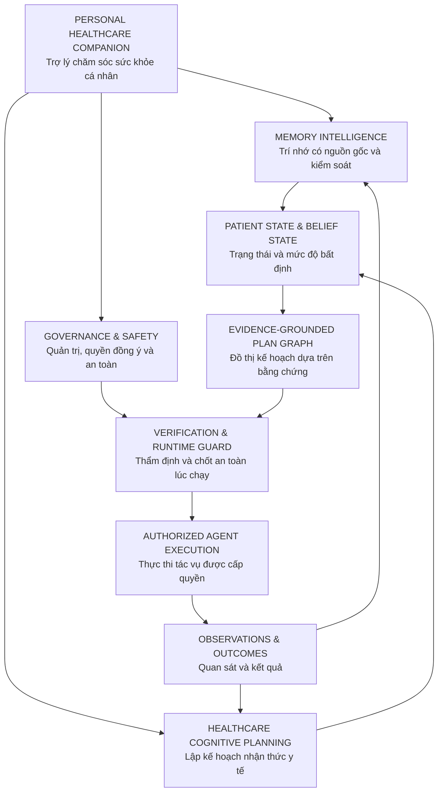

# Trung tâm tài liệu kỹ thuật Y TẾ MỞ

Đây là **bản đồ điều hướng tài liệu** của dự án. Chọn một khối bên dưới để mở đúng phần kiến trúc tương ứng.

> Các sơ đồ mô tả kiến trúc mục tiêu. Chúng không tự chứng minh rằng chức năng đã được triển khai. Trạng thái thực tế phải được đối chiếu với mã nguồn, migration, API và kiểm thử.

## Bản đồ kiến trúc tổng thể

## Chọn khu vực muốn tìm hiểu

### 1. Memory Intelligence — Trí nhớ thông minh
| Thành phần | Nội dung | Mở tài liệu |
|---|---|---|
| Kiến trúc tổng thể | Vai trò Memory trong toàn hệ thống | [Kiến trúc đích](README_MEMORY_PLANNING.vi.md#1-kiến-trúc-đích) |
| Nguồn gốc tri thức | Provenance, Evidence Lineage, truy vết nguồn | [Nguồn gốc và bằng chứng](README_MEMORY_PLANNING.vi.md#31-provenance-aware-memory--evidence-lineage) |
| Thời gian và lịch sử | Bitemporal, Event Sourcing, phiên bản | [Bộ nhớ hai trục thời gian](README_MEMORY_PLANNING.vi.md#32-bitemporal--event-sourced-memory) |
| Xử lý mâu thuẫn | Conflict-aware Memory, Truth Maintenance | [Bộ nhớ xử lý xung đột](README_MEMORY_PLANNING.vi.md#33-conflict-aware-memory--truth-maintenance) |
| Tri thức suy dẫn | Derived Memory, Dependency Graph | [Bộ nhớ suy dẫn](README_MEMORY_PLANNING.vi.md#34-derived-memory-dependency-graph--incremental-revalidation) |
| Hợp nhất trí nhớ | Consolidation, Multi-timescale Memory | [Hợp nhất trí nhớ](README_MEMORY_PLANNING.vi.md#35-memory-consolidation--multi-timescale-memory) |
| Quyền riêng tư | Consent-aware Retrieval, Purpose Limitation | [Truy xuất theo quyền đồng ý](README_MEMORY_PLANNING.vi.md#36-consent-aware-retrieval--purpose-limitation) |
| Ghi nhận thay đổi | Transactional Audit, Memory Lifecycle | [Kiểm toán và vòng đời](README_MEMORY_PLANNING.vi.md#37-transactional-audit--memory-lifecycle) |
| Luồng truy xuất | Tìm kiếm, lọc quyền, xếp hạng và đưa vào ngữ cảnh | [Memory Retrieval Pipeline](README_MEMORY_PLANNING.vi.md#4-memory-retrieval-pipeline) |

### 2. Healthcare Cognitive Planning — Lập kế hoạch nhận thức y tế
| Thành phần | Nội dung | Mở tài liệu |
|---|---|---|
| Vòng lặp lập kế hoạch | Quan sát → suy luận → lập kế hoạch → thực thi → đánh giá | [Planning Cognitive Loop](README_MEMORY_PLANNING.vi.md#5-planning-là-một-cognitive-control-loop) |
| Trạng thái bệnh nhân | Patient State, Belief State, State Estimation | [Patient State và Belief State](README_MEMORY_PLANNING.vi.md#6-patient-state-belief-state--state-estimation) |
| Mục tiêu chăm sóc | Goal & Intent Management | [Quản lý mục tiêu](README_MEMORY_PLANNING.vi.md#7-goal--intent-management) |
| Bằng chứng y khoa | Clinical Evidence, Evidence-grounded Reasoning | [Suy luận dựa trên bằng chứng](README_MEMORY_PLANNING.vi.md#8-clinical-evidence--evidence-grounded-reasoning) |
| Chủ động thu thập thông tin | Active Information Planning, Value of Information | [Giá trị thông tin](README_MEMORY_PLANNING.vi.md#9-active-information-planning--value-of-information) |
| Lập lịch và tài nguyên | HTN, Temporal Planning, Constraint Scheduling | [Lập kế hoạch phân cấp và theo thời gian](README_MEMORY_PLANNING.vi.md#10-hierarchical-temporal--resource-constrained-planning) |
| Tìm kiếm phương án | Beam Search, MCTS, Constraint Solving, Meta-planning | [Tìm kiếm và tối ưu phương án](README_MEMORY_PLANNING.vi.md#11-candidate-search-optimization--inference-time-compute) |
| Nhân quả | Causal và Counterfactual Planning | [Lập kế hoạch nhân quả](README_MEMORY_PLANNING.vi.md#12-causal--counterfactual-planning) |
| Rủi ro và ràng buộc | Risk-aware Planning, Hard Constraints | [Lập kế hoạch có kiểm soát rủi ro](README_MEMORY_PLANNING.vi.md#13-risk-aware-planning--hard-constraints) |
| Thẩm định độc lập | Verification, Runtime Assurance | [Thẩm định và chốt an toàn](README_MEMORY_PLANNING.vi.md#14-independent-verification--runtime-assurance) |
| Theo dõi dài hạn | Adaptive Replanning, Longitudinal Continuity | [Lập kế hoạch lại thích ứng](README_MEMORY_PLANNING.vi.md#15-adaptive-replanning--longitudinal-continuity) |
| Đánh giá và giám sát | Multi-perspective Evaluation, Human Oversight | [Đánh giá đa góc nhìn](README_MEMORY_PLANNING.vi.md#16-multi-perspective-evaluation--human-oversight) |
| Đồ thị kế hoạch | Patient-centric Plan Graph | [Đồ thị kế hoạch bệnh nhân](README_MEMORY_PLANNING.vi.md#17-patient-centric-plan-graph) |

### 3. Triển khai, kiểm thử và quản trị
- [Luồng nhận thức đầu-cuối](README_MEMORY_PLANNING.vi.md#18-end-to-end-cognitive-loop)
- [Vai trò Agent và Workflow](README_MEMORY_PLANNING.vi.md#19-agent-và-workflow-không-thay-thế-planner)
- [Bộ tiêu chí Benchmark](README_MEMORY_PLANNING.vi.md#20-benchmark-bắt-buộc)
- [Lộ trình triển khai](README_MEMORY_PLANNING.vi.md#21-lộ-trình-triển-khai-thực-tế)
- [Ma trận trạng thái triển khai](README_MEMORY_PLANNING.vi.md#22-ma-trận-trạng-thái-triển-khai)
- [Các nguyên tắc bất biến](README_MEMORY_PLANNING.vi.md#23-nguyên-tắc-bất-biến)

## Quy ước đọc tài liệu

- **Đã triển khai:** có mã nguồn, tích hợp và kiểm thử chứng minh.
- **Triển khai một phần:** mới có một phần hoặc thiếu kiểm chứng.
- **Đề xuất:** kiến trúc mục tiêu, chưa có bằng chứng triển khai.
- **Chưa xác minh:** có dấu hiệu tồn tại nhưng chưa kiểm toán đủ.

Thuật ngữ kỹ thuật phổ biến như `Memory`, `Planning`, `Belief State`, `MCTS`, `HTN`, `Runtime Assurance` được giữ nguyên trong ngoặc hoặc trong tên chuẩn để tránh dịch sai nghĩa. Phần giải thích và hướng dẫn được viết bằng tiếng Việt.
